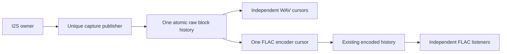

# Capture publication proposal — dp08

**Status:** Doctor Biz approved this reviewed design with “continue.”
Implementation is tracked in [the execution plan](2026-10-08-capture-publication-implementation.md).
Target feasibility, concurrency proof and hardware acceptance remain gates.
Parent owns builds, board, Git and acceptance evidence.

## Problem and scope

The retained `target/tls-capture/task-map-repeat` run distinguishes software
publication loss from the earlier DMA starvation: queue overflows/restarts
stayed 12/1, while software dropped frames rose 240→4,560 (+4,320), gaps rose
1→3, staging reached its 2,160-frame limit, and pending-publication window maxima
were 22 attempts and 112,352 us. Raw-reader closure wall time reached 110,567 us.
These supplied observations support the reader-mutex/staging failure path;
closure wall time includes preemption and does not measure pure copy CPU cost.

`CaptureBuffer::publish` uses `try_lock`, then stages at most 45 ms while a
reader holds the mutex (`core/src/capture_buffer.rs:31–59`). Exhaustion drops
staged frames and invalidates old cursors. `read_some` holds that same mutex
through `StreamRing::read` (`firmware/src/stream.rs:360–375`). A preempted
reader therefore can exhaust producer staging even while I2S keeps progressing.

Success means a paused raw reader cannot cause capture publication drops,
resets, or waits. It may lose its own stale data. This proposal does **not**
fix core-0 scheduling/cache stalls that separately overflow the I2S DMA queue.
Do not close that gate merely because reader isolation passes.

Preserve:

- Real 48 kHz stereo capture, sign-extended 24-bit samples, PGA and routing.
- WAV s24le and the single shared 16-bit FLAC encoder, with independent reader
  cursors and existing FLAC frame numbering/CRC behavior.
- Two seconds of raw history with recognition off: 96,000 frames. Keep the
  existing recognition-on 0.5 s profile; do not silently add 576 KB there.
- Complete 240-frame/5 ms publication, bounded boot allocation, and no capture
  hot-path allocation. Reads may consume part of a published block.
- Existing capture-overflow invalidation, settling, recognition/meter reset,
  3 s capture-health restart/reboot policy, reader freshness timeout, socket
  write deadlines, listener slots, Stop/autoplay behavior and encoded history.
- No credentials/media reads, speaker or Wi-Fi settings changes, fake device
  modes, or live Shazam calls for acceptance.

## Recommendation: one shared block history

Replace the raw reader mutex and contention staging with a single preallocated
block ring. Its samples are `AtomicI32`; metadata uses `AtomicU32` only. Both
WAV readers and the existing shared FLAC encoder read the same raw history.
The producer performs a fixed amount of work and never checks reader ownership,
spins for readers, or allocates. Consumers own their copy buffers and cursors.

Use a unique, non-Clone producer token. Only its `publish(&mut self, ...)` and
`invalidate(&mut self)` methods mutate the publication protocol. Return a
cloneable read handle separately. Do not expose writer methods on an `Arc`
through `&self`; one-writer intent must be enforced by Rust borrowing, not a
comment. Tentative construction is `(CapturePublisher, Arc<StreamRing>)`;
`SharedStreamRing` becomes `Arc<StreamRing>`.

Keep the public reader operations `capacity`, `cursor_now`, and `read` with
private cursor fields. A read copies at most one block fragment/240 frames.
The FLAC encoder sometimes requests only 16 frames to finish its 4,096-frame
block (`stream.rs:437–439`); it must retain an offset within the raw block and
consume its remaining frames later. Complete publication does not require
complete-block consumption.

## Publication and validation protocol

This is the proposed protocol to review and model before implementation.
Begin with SeqCst for **all** shared protocol and payload loads/stores. Do not
weaken ordering while also changing ownership. SeqCst does not itself prove
the protocol correct; the acceptance below includes an explicit ordering proof.

1. A writer-local, fixed 240-frame accumulator coalesces short whole-frame
   I2S reads. Only complete stereo blocks become visible. Invalidation discards
   any unpublished partial block and counts those actual discarded frames.
   No reader delay can fill this accumulator: it exists for block assembly.
2. The writer privately owns 64-bit logical block/frame position and generation,
   plus a 32-bit publication sequence/era. Shared 64-bit values use two
   `AtomicU32` words guarded by the header protocol; never `AtomicU64`.
3. A global header has a busy/even sequence, a publication era, split logical
   head/generation, and retained-block count. Each slot has its own busy/even
   stamp. Before mutating a slot or reset metadata, the writer marks the global
   header busy and that slot busy; it stores all 480 atomic samples, then marks
   the slot committed. It updates head/retained count and commits the global
   header last. A preempted writer exposes no new complete block.
4. Header snapshots are bounded attempts: load era/sequence, reject busy,
   load head/generation/count words, then validate sequence and era again.
   A failed validation yields Retry, not an unbounded spin or false success.
5. A reader takes a coherent header snapshot, checks its generation and lag,
   loads an even slot stamp, copies through atomic payload loads, then checks
   the stamp again. It takes another coherent header snapshot and rechecks
   generation, requested frame's retention and publication era. Accept only
   an unchanged slot stamp within the same publication era and a still-valid
   cursor range. Advance the cursor only on acceptance. An unsuccessful copy
   stays scratch data and must never reach a socket or encoder.

Readers return distinct Data, CaughtUp, Retry and Overrun outcomes internally.
`read_fresh` can sleep one tick on CaughtUp or Retry within the existing 2 s
freshness budget; Overrun remains an immediate discontinuity. No consumer spins
on a busy slot/header. Cursor initialization must likewise retry a busy header
within the existing bounded budget; do not fabricate a cursor from torn words.

The global busy marker matters even for old slots: until head commit, a reader
must not accept a slot already overwritten for a publication not yet reflected
in the head. The post-copy head snapshot closes that interval. A successful
copy linearizes at a validated committed state; producer activity on another
slot alone should not invalidate the copied slot.

### Wrap, reset and ABA

Physical slot wrap uses the writer's logical block position modulo the configured
400 or 100 slots; it must not depend on a truncated counter modulo 400. Cursor
positions remain 64-bit local values. Reset increments the logical generation
and publishes zero retained blocks through the same busy-header protocol.
Existing cursors then get Overrun, including during a partially filled block;
WAV disconnects and FLAC invalidates encoded cursors/discards its partial block.

A finite stamp can repeat while a reader is suspended. Add a 32-bit global
publication era that advances **inside a busy header before publication sequence
wrap commits**. Every publication/reset counts toward that wrap. Slot stamps
must come from that publication sequence, so a stamp cannot repeat within an
era. Both header snapshots bracket payload validation with an era check. A
reader suspended across stamp wrap rejects the copy, even if its slot stamp
matches again. This avoids relying on a reader finishing within a guessed time.

The era itself must never silently wrap: checked exhaustion is a terminal
publication error, as is exhaustion of the private 64-bit position/generation.
The eventual implementation plan must spell out the firmware's fatal-error
handling; it must not forge continuity or reset an exhausted era to zero while
old readers remain. This is an explicit design-review point, not an assertion
that the complete ABA proof has passed. Seed counters near boundaries in tests;
do not wait months to exercise rollover.

## Rust safety and ESP32 placement gates

Atomic payload access prevents Rust data races even when copying overlaps
overwrite. `UnsafeCell<i32>`, raw non-atomic reads, volatile payload access or
two sequence checks around an ordinary `copy_from_slice` are **not** acceptable.
Keep published storage fixed in size/address; expose no mutable/non-atomic
alias after sharing. Vec growth, raw casting of an existing live `Vec<i32>` into
atomic storage, and an unproved `unsafe impl Sync` are outside this design.

Pinned evidence is local ESP-IDF 5.5.5:

- `components/newlib/priv_include/esp_stdatomic.h:21–24` explicitly has no
  Xtensa 64-bit atomics. `src/stdatomic.c:20–22,59–85` implements unsupported
  operations using a global atomic spinlock.
- Effective generated sdkconfig currently has
  `CONFIG_STDATOMIC_S32C1I_SPIRAM_WORKAROUND=y`. Kconfig:210–212 defaults it for
  PSRAM ESP32/ESP32S3 GCC builds; it does not establish Rust LLVM lowering.
- `esp_stdatomic.h:47–48,52–85,163–170,189–196` can route external-RAM atomic
  load/store helpers through that critical-section lock. Internal addresses
  take the hardware stub path. Thus even an AtomicI32 load/store declaration
  does not establish that its generated operation avoids a lock.
- `components/esp_hw_support/cpu.c:203–222` says native CAS cannot be used on
  external RAM and supplies an external-RAM lock workaround. Do not place
  fetch-add/CAS/refcount RMW operands in PSRAM on an assumption of support.
- `docs/en/api-guides/external-ram.rst:106–111` describes malloc preference and
  fallback, not guaranteed placement. Defaults use threshold 8191. The same
  document:215,225 says cache-off makes external RAM inaccessible and notes
  shared cache/bandwidth costs.

Payload belongs in PSRAM; metadata and Arc/refcount objects belong in internal
RAM. Start with ordinary owned typed storage and verified address placement;
if allocator fallback violates that requirement, use a narrowly owned IDF
capability allocation rather than silently accepting it. Any such allocator
bridge needs its own alignment, initialization, Send/Sync and matching-free
review. No hot-path RMW is needed: the sole writer computes next values locally
and stores them. Consumers only load shared samples/metadata.

Before accepting this architecture on ESP32, inspect a real linked candidate's
publisher/reader and callees with the existing pinned objdump. Require aligned
32-bit payload load/store plus the required ordering, no PSRAM `s32c1i`, no
64-bit helpers, and no global-lock helpers in raw publication/copy. If lowering
introduces those locks, this recommendation has failed its feasibility gate;
do not declare reader isolation or hide it by changing memory ordering.
These instruction/placement claims are gates, not measured results today.

## Cost and alternatives

At the off-profile bound, 400 × 240 × 2 × 4 = 768,000 bytes of payload, matching
current raw history. Expected slot stamps cost 1,600 internal bytes; the proposed
seven-word header costs 28 bytes before owner/allocation overhead. One assembly
block costs 1,920 bytes and replaces 17,280 bytes of contention staging. This is
about 13.7 KB less payload/storage overall, subject to actual layouts and
allocator overhead. Budget roughly 3,548 additional internal bytes off-profile
for 1,600 bytes of stamps, the 28-byte header and a 1,920-byte assembly block,
plus ownership/allocation overhead, if the old contention staging is in PSRAM.
Total storage savings do not imply more internal memory for TLS. The enabled
profile uses 100 slots and retains its history budget. Verify every allocation's
actual placement and the net internal delta in the real image.

Capture performs 96,000 sample stores/s. Each full-rate raw reader performs
96,000 sample loads/s; two WAV readers plus the always-running shared encoder
can reach 288,000 loads/s. SeqCst/cache cost may be material. No CPU improvement
is claimed. Measure capture and encoder task runtime, service delay, internal
minimum heap/largest block, PSRAM usage and stacks against the current profile.
No new publication task or stack is proposed.

| Alternative | Assessment |
| --- | --- |
| SPSC feeding FLAC plus a separate WAV history | Does not preserve both raw consumer roles by itself; adds another publication/history path and reset/accounting source. Reject for this bounded change. |
| Preallocated immutable block pool with reader pins | Can avoid atomic payload copies, but needs reader registration, spare-buffer accounting, lifetime-safe pin/reclaim and ABA protection. Keep as fallback if the atomic payload's lowering or measured cost fails. |
| Larger staging or shorter locked reads | Retains scheduling-dependent producer loss. Does not satisfy reader isolation. |

Expected changed scope is `core/src/stream_ring.rs`, `core/src/capture_buffer.rs`
(writer ownership/assembly), their tests, `firmware/src/audio_in.rs` and the raw
read/cursor paths of `firmware/src/stream.rs`. Encoded history, FLAC bit-depth
conversion, HTTP formats and transport control remain shared implementations.
Estimate 350–550 changed production Rust lines plus 300–450 test/model lines;
an allocator bridge, if needed, adds roughly 60–100 lines. This estimate is not
permission for a wider rewrite.

## Evidence required before shipping

1. **TDD with real ring code:** red tests first for unique writer ownership,
   incomplete blocks remaining invisible, whole stereo frames, reader offsets
   across the 4,096-frame encoder boundary, independent cursors, exactly-full
   history versus overwritten history, reset during partial assembly/copy,
   scratch-copy rejection and unchanged cursor on Retry/Overrun. Verify fixed
   storage/capacity through repeated wrap and reset. No mocked producer or reader.
2. **Property tests:** actual randomized publish/read/reset schedules compared
   with a sequential reference history, distinct channel/frame identifiers,
   variable whole-frame input/output lengths, cursor lag, physical wrap, split
   head-word carry, sequence/era rollover and checked exhaustion. A reference
   model is an oracle, not a mock of the implementation.
3. **Concurrency proof and Loom:** explain writer-before-head ordering, accepted
   payload coherence, era ABA protection and reset behavior. Add a test-only
   atomic backend using Loom on the same protocol code, not a separate imitation.
   Model tiny blocks with one writer/two readers, pauses at each publication and
   validation step, overwrite/reset and explicitly seeded wrap boundaries.
   Assert accepted output never mixes identifiers and rejected reads do not
   advance cursors. Bound interleavings explicitly; passing a bounded model is
   supporting evidence, not proof of unbounded progress. Loom is not currently
   a dependency; pin an available version only after approval and verification.
4. **Real threaded host integration:** barriers pause an actual reader mid-copy
   while an actual producer publishes more than 45 ms and then more than two
   seconds of samples. Producer completes without reader release; the other
   reader stays coherent, and the stale reader retries/overruns. Exercise actual
   WAV packing and FLAC encode/decode with deterministic channel-distinct input,
   exact decoded sample counts, reset and real loopback socket backpressure.
   Diagnostic/test synchronization must not become a production fault mode.
5. **Hardware:** use a diagnostic-only forced slow raw reader, with bounded
   suspension/resume and lifetime-safe handles, beside production capture and
   one/two real listeners. Pause for roughly 110–200 ms and beyond two seconds.
   Require unchanged queue-overflow/restart/software-drop/gap totals during the
   isolated reader test; stale-reader disconnect is expected after history loss.
   Then repeat real three-cycle TLS, reconnect/NVS coverage and exact decoder
   gates. Retain failures and distinguish DMA faults from publication faults.
6. **Contracts and cost:** preserve short-pause/stall/restart/reboot health tests,
   listener-slot release, fresh-data/write deadlines and Stop/autoplay-off tests.
   A publication test must not require a Sonos command or setting write. Compare
   CPU/heap/stack and linked placement with a paired current image, verify both
   recognition profiles compile, and run canonical `scripts/check` plus an
   independent concurrency review before calling dp08 fixed.

The physical known-signal gate remains separate: disconnected LINE IN cannot
certify signal fidelity or settling. Real ring/codec decoder accounting can
validate transport structure on quiet input; it does not invent a physical signal.

## Decision to discuss

Recommend the single atomic-payload history, subject to the ordering/ABA review
and ESP32 load/store feasibility/cost gates above. Doctor Biz approved this
architecture after the independent review. Implementation must satisfy the
unresolved gates before claiming reader isolation or closing dp08.

## Independent design review

The Sol concurrency reviewer found no blocking protocol defect in this proposal.
Review checked slot/payload ordering, post-copy header validation, era exhaustion,
unique writer ownership, partial reads and the seven-word header calculation.
The document now distinguishes independent telemetry maxima and internal-memory
cost from total storage savings. This is review of a proposed protocol, not a
substitute for the ordering proof, Loom model, linked-image checks or hardware
acceptance. Fix snapshot attempt limits and terminal exhaustion handling in the
implementation plan before coding.
